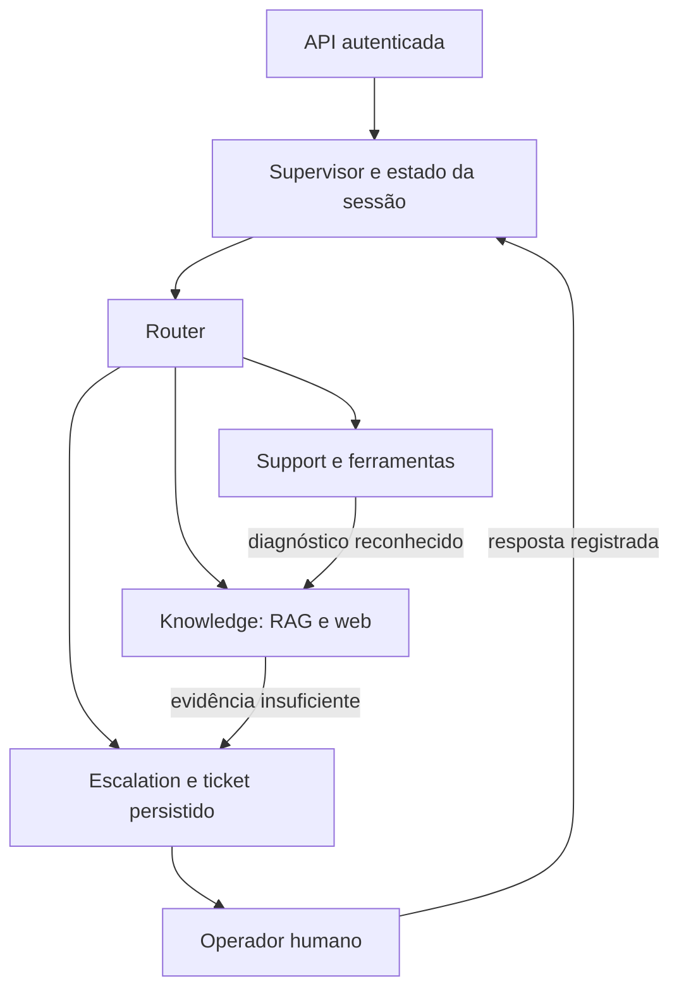

# AI Hardcore Engineer V3 — candidato 1.4

Sistema demonstrativo de atendimento com quatro agentes, API FastAPI, RAG sobre fontes Getnet, busca web, autenticação, histórico SQLite e atendimento humano no chat.

A evolução da V2 acrescenta sessões persistidas, identificação do usuário pelo token, uma cadeia de colaboração entre especialistas e tickets que o operador pode assumir, responder e fechar. A aplicação foi executada localmente no Windows com Docker Desktop e Ollama.

**Vídeo:** em preparação. Adicionar aqui o link acessível antes da submissão.

## Capacidades

| Componente | Comportamento implementado |
| --- | --- |
| Router | Políticas de intenção e classificação pelo modelo em casos incertos; escolhe Knowledge, Support ou Escalation. |
| Supervisor | Coordena o turno, recupera estado da sessão, interpreta referências previstas e persiste mensagens e resultados. |
| Knowledge | Consulta RAG Getnet e busca web. Para produtos, o modelo seleciona trechos identificados; a aplicação valida as referências. |
| Support | Usa `customer_lookup`, `payment_status` e `transaction_lookup` com a identidade autenticada. |
| Escalation | Solicita encaminhamento; o Supervisor cria ou reutiliza um ticket persistido. |
| Operador | Assume o ticket, responde na conversa do cliente, resolve e fecha o atendimento. |

### Memória e colaboração

`session_id` identifica a conversa. Mensagens e estado persistem em SQLite: produto selecionado, candidatos, assuntos visitados, ferramenta de conta anterior e ticket. O Supervisor consulta as últimas 12 mensagens; o histórico completo permanece disponível pela API. Referências previstas a um produto podem manter o assunto; referências ambíguas podem solicitar esclarecimento.

Existe uma cadeia limitada **Support → Knowledge** para problemas de conexão reconhecidos: Support consulta o cliente autenticado, seu resultado entra como contexto para Knowledge e o Supervisor compõe a resposta ou encaminha. As etapas e a entrada da colaboração aparecem na metadata. Não há replanejamento aberto nem memória semântica geral.



## Executar com Docker e Ollama

Pré-requisitos: Docker Desktop com containers Linux, Ollama ativo no host e internet para ingestão/busca. O container instala Python e dependências; não exige `.venv` no Windows.

### 1. Configurar o ambiente

Na pasta com `docker-compose.yml`, para uma instalação nova:

```powershell
Copy-Item .env.example .env
notepad .env
```

Em uma instalação existente, preserve o `.env` atual. Defina:

- `AUTH_SECRET`: segredo aleatório com pelo menos 32 caracteres.
- `DEMO_PASSWORD`: senha local com pelo menos 10 caracteres.
- `LLM_PROVIDER=ollama`.
- `OLLAMA_CHAT_MODEL=llama3.2:3b`.
- `OLLAMA_EMBED_MODEL=nomic-embed-text:latest`.

Configuração de referência para a demonstração local:

```dotenv
LLM_PROVIDER=ollama
OLLAMA_BASE_URL=http://localhost:11434
OLLAMA_CHAT_MODEL=llama3.2:3b
OLLAMA_EMBED_MODEL=nomic-embed-text:latest
REQUEST_TIMEOUT_S=120
CHAT_BUDGET_S=180
LLM_MAX_OUTPUT_TOKENS=96
```

Esses limites não garantem determinada latência. O orçamento é verificado entre etapas e limita timeouts de rede; não é um cancelamento absoluto da geração no servidor Ollama.

O Compose substitui o endereço do modelo por `http://host.docker.internal:11434` dentro do container. Mantenha o Ollama aberto. Verifique os modelos:

```powershell
ollama list
```

Se faltarem:

```powershell
ollama pull llama3.2:3b
ollama pull nomic-embed-text:latest
```

### 2. Construir e provisionar

Os comandos usam um nome fixo de projeto para reutilizar o mesmo volume mesmo que a pasta seja renomeada.

```powershell
docker compose -p ai-hardcore-engineer-v3-evoluido build
docker compose -p ai-hardcore-engineer-v3-evoluido run --rm api python scripts/init_demo.py
```

O provisionamento cria `cliente1988`, `cliente2026` e `operador`, usando a senha configurada. São identidades de demonstração. Reexecutar o provisionamento troca os hashes das senhas; não é necessário para cada reinício.

### 3. Construir o índice e iniciar

```powershell
docker compose -p ai-hardcore-engineer-v3-evoluido run --rm api python -m app.rag.ingest --ollama-embeddings
docker compose -p ai-hardcore-engineer-v3-evoluido up -d
docker compose -p ai-hardcore-engineer-v3-evoluido ps
Invoke-RestMethod -Uri "http://127.0.0.1:8000/health"
```

Interface: <http://127.0.0.1:8000/>. Swagger: <http://127.0.0.1:8000/docs>.

O volume `state` mantém índice, sessões, tickets e identidades provisionadas. `down -v` remove os volumes do projeto; não use esse comando para uma atualização que deva preservar os dados.

Depois de alterar código:

```powershell
docker compose -p ai-hardcore-engineer-v3-evoluido up -d --build --force-recreate
```

Reconstrua o índice se mudar fontes, extração, chunking ou embeddings. Reinicie o container após a reconstrução. Se atualizar apenas a seleção de resposta da 1.4, o índice existente pode ser reutilizado.

## RAG e respostas

Pipeline: HTML → remoção de navegação e scripts → títulos/seções → chunks com metadata → deduplicação → embeddings → índice NumPy persistente → recuperação vetorial e lexical → filtros de relevância → evidências apresentadas.

Fontes padrão:

- <https://www.getnet.net/en>
- <https://www.getnet.net/en/our-solutions/online-payments>
- <https://site.getnet.com.br/pix/>
- <https://site.getnet.com.br/link-de-pagamento/>
- <https://site.getnet.com.br/conta-digital/>

`RAG_SOURCE_URLS` permite configurar URLs separadas por ponto e vírgula. `RAG_TOP_K` e `RAG_MIN_SCORE` controlam a recuperação. O índice registra origem, URL, seção, documento e chunk, além de manifesto e identificação do provedor/modelo de embeddings. NumPy atende ao corpus pequeno desta demonstração e mantém a implementação inspecionável.

Na 1.4, o cliente Ollama solicita uma seleção em schema JSON, limitada aos IDs dos candidatos existentes. A aplicação valida o formato e apresenta o texto dos trechos. Isso verifica a origem do conteúdo; não prova relevância, completude, atualidade ou veracidade da fonte.

Catálogo, modalidades Pix, ofertas comerciais e procedimentos completos podem usar extrações identificadas. Perguntas gerais podem usar geração baseada nos snippets web. `generation_kind`, `llm_selected` e `llm_generated` distinguem seleção pelo modelo, extração e geração livre. `answered` é um resultado técnico, não uma nota de qualidade factual.

Busca web usa DuckDuckGo HTML, sem API paga. Páginas que apenas anunciam cotação ou previsão podem não fornecer os valores necessários. Nessas situações, a aplicação pode se abster e encaminhar.

Para uma demonstração offline explicitamente sintética:

```powershell
docker compose -p ai-hardcore-engineer-v3-evoluido run --rm api python -m app.rag.ingest --seed
```

O seed substitui o índice por dados demonstrativos e não comprova fatos atuais da Getnet. Para a demonstração real, ingira novamente sem `--seed`.

## API e atendimento humano

Autentique em `POST /auth/login` com `username` e `password`. Use o token retornado no header `Authorization: Bearer TOKEN` das operações privadas.

| Método e rota | Uso |
| --- | --- |
| `GET /health` | Status básico, provedor configurado e existência do índice. |
| `GET /ready` | Verificações adicionais de índice e disponibilidade do modelo configurado. |
| `POST /sessions` | Criar conversa do cliente autenticado. |
| `GET /sessions` | Listar conversas próprias. |
| `GET /sessions/{id}/messages` | Consultar histórico próprio. |
| `POST /chat` | Processar uma mensagem na sessão. |
| `GET /tickets` | Listar tickets conforme o papel e a identidade. |
| `GET /tickets/{id}` | Consultar ticket autorizado. |
| `POST /tickets/{id}/reply` | Operador/admin atualizar atendimento e responder. |
| `GET /metrics` | Métricas para operador/admin. |

Exemplo de payload de chat:

```json
{
  "message": "Como criar esse Link de Pagamento?",
  "session_id": null
}
```

Sem `session_id`, o servidor cria uma conversa. Nos turnos seguintes, reutilize o ID retornado. `user_id` é opcional; se enviado, precisa coincidir com o token. A identidade efetiva das ferramentas vem do servidor, não do texto ou da decisão do modelo. Mensagens têm limite de 4.000 caracteres e há limite de 30 requisições por minuto por identidade.

Tickets seguem **OPEN → IN_PROGRESS → RESOLVED → CLOSED**. O operador assume, responde para resolver e depois fecha. A resposta humana é persistida na sessão e exibida ao cliente; um operador diferente não pode resolver um ticket atribuído a outro, salvo autorização de admin.

A interface diferencia cliente, assistente e operador, mostra fontes deduplicadas, histórico e estado do ticket. Enter envia; Shift+Enter quebra linha. Atualização de mensagens/tickets depende das ações da interface e do polling, não de streaming da geração.

## Segurança e operação

- Senhas armazenadas como hashes PBKDF2 com salt; segredo e senha de provisionamento vêm do ambiente.
- Tokens HMAC assinados expiram em uma hora; permissões dependem da identidade provisionada.
- Sessões e tickets verificam propriedade e papel. A segurança não depende da confiança declarada pelo modelo.
- Guardrails bloqueiam padrões conhecidos de instruções maliciosas e pedidos de segredo. Não representam proteção universal contra prompt injection.
- Logs estruturados correlacionam requests, agentes, ferramentas, fontes, tempos e motivos de encaminhamento sem registrar o texto integral da conversa ou credenciais.
- Container executa como usuário sem privilégios e publica a API apenas em `127.0.0.1:8000` na configuração padrão.

Métricas incluem erros, fallbacks, escalonamentos, resultados técnicos e latências. São mantidas por processo, reiniciam com a aplicação e não substituem uma avaliação factual. Não há dashboard externo, tracing distribuído ou alertas operacionais. A implantação usa um worker; não foi validada como serviço de produção distribuído.

## Testes e evidências

Verificações executadas na versão 1.4:

| Verificação | Resultado observado |
| --- | --- |
| Testes automatizados | **149 passaram**, com um aviso de depreciação do TestClient. |
| Runner offline | **17 cenários**, com verificações de contratos atendidas. |
| Desenvolvimento com Ollama | **20 cenários / 34 respostas**, sem erros de captura. |
| Validation com Ollama | **10 cenários / 16 respostas**, sem erros de captura. |
| Ambiente local | Build Docker, ingestão com Ollama e API saudável confirmados no Windows do autor. |

As capturas reais foram revisadas e revelaram limitações de interpretação e relevância. HTTP 200, ausência de erro de captura e presença de fonte não significam que uma resposta atendeu ao pedido. O conjunto validation não recebeu aprovação integral de qualidade.

Execute testes e avaliação offline como usuário normal do container:

```powershell
docker compose -p ai-hardcore-engineer-v3-evoluido exec api python -m pytest -q -p no:cacheprovider
docker compose -p ai-hardcore-engineer-v3-evoluido exec api python -m evaluation.run --output /state/offline_report_final.json
```

O runner offline usa índice temporário, busca web simulada e geração desabilitada. Suas métricas medem roteamento, ferramenta, presença de fontes/excertos e comportamento de falha; não são uma nota de factualidade do modelo.

Captura real, com aplicação e Ollama ativos:

```powershell
docker compose -p ai-hardcore-engineer-v3-evoluido exec api python -m evaluation.live --dataset development --repetitions 1 --timeout 300 --output /state/live_development_final.json
docker compose -p ai-hardcore-engineer-v3-evoluido cp api:/state/live_development_final.json .\live_development_final.json

docker compose -p ai-hardcore-engineer-v3-evoluido exec api python -m evaluation.live --dataset validation --repetitions 1 --timeout 300 --output /state/live_validation_final.json
docker compose -p ai-hardcore-engineer-v3-evoluido cp api:/state/live_validation_final.json .\live_validation_final.json
```

Os relatórios registram hashes de código/dataset, modelo configurado no health, tempos e resultados. As capturas desta entrega usaram uma repetição. A estabilidade em três repetições e o QA visual automatizado permanecem pendentes. As rubricas de revisão estão em [evaluation/RUBRIC.md](evaluation/RUBRIC.md).

Na organização da entrega, preserve as capturas revisadas como evidência; relatórios anteriores às atualizações devem ser identificados como históricos. [RELATORIO_ATUALIZACAO_1.4.md](RELATORIO_ATUALIZACAO_1.4.md) descreve a última alteração e seus limites. Não tratar documentos de revisões anteriores como aprovação do candidato atual.

## Limitações conhecidas

A persistência e o fluxo humano estão implementados, mas a compreensão semântica continua limitada: paráfrases podem encaminhar incorretamente ou selecionar ferramenta inadequada; comparações podem recuperar apenas um produto; trechos válidos podem ser fragmentados, promocionais ou estar no idioma original. A cobertura das fontes sobre Get Smart/Get Clássica é insuficiente em alguns cenários. Cotação, clima e condições comerciais dependem de evidências efetivamente disponíveis.

A demonstração usa dados sintéticos de conta e não consulta sistemas transacionais reais da Getnet. Autenticação, guardrails e testes de isolamento são componentes de demonstração, sem certificação de segurança de produção. A versão não oferece garantia de atendimento completo ou de precisão de 100%.

## Desenvolvimento sem Docker

Alternativa para Python 3.12 local:

```powershell
powershell.exe -NoProfile -ExecutionPolicy Bypass -File .\scripts\setup_windows.ps1
notepad .env
.\.venv\Scripts\python.exe scripts/init_demo.py
.\.venv\Scripts\python.exe -m app.rag.ingest --ollama-embeddings
.\.venv\Scripts\python.exe -m uvicorn app.main:app --host 127.0.0.1 --port 8000
```

Configure `.env` antes do provisionamento/ingestão e mantenha Ollama ativo. Não é necessário ativar o venv quando se usa o caminho completo do executável.

## Documentação e submissão

[SPEC.md](SPEC.md), [ARCHITECTURE.md](ARCHITECTURE.md), [ACCEPTANCE_CRITERIA.md](ACCEPTANCE_CRITERIA.md), [REQUIREMENTS_MATRIX.md](REQUIREMENTS_MATRIX.md) e [IMPLEMENTATION_PLAN.md](IMPLEMENTATION_PLAN.md) documentam o processo SDD e as decisões. Documentos produzidos antes das capturas reais devem ser lidos com seus respectivos escopos e datas.

O [ROTEIRO_VIDEO.md](ROTEIRO_VIDEO.md) orienta a demonstração: arquitetura, resposta com fonte, continuidade, consulta autenticada e atendimento humano de ponta a ponta. Conferir os fluxos no navegador antes de gravar e acrescentar o link do vídeo no início deste README. A entrega é local; não há URL pública de aplicação declarada.

Antes de publicar no GitHub, revisar a lista efetivamente versionada. Preservar `.env.example`, código, testes e evidências revisadas; excluir `.env`, senhas/hashes provisionados, banco local, caches, venv e pastas de backup. `.gitignore` não remove arquivos já versionados. Não publicar credenciais no vídeo ou nos relatórios. A versão demonstra os componentes implementados e registra os limites observados, sem atribuir a si mesma uma nota de avaliação.
