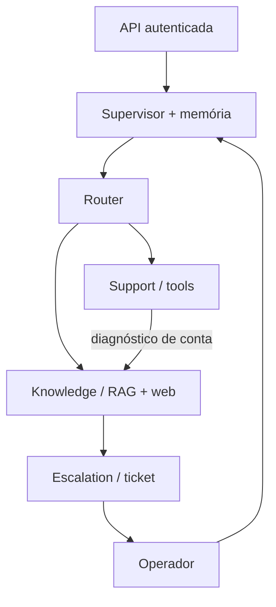

# AI Hardcore Engineer V3

Sistema demonstrativo com Router, Knowledge, Support e Escalation; API FastAPI; RAG; autenticação; memória SQLite; operador humano e chat web. Reutiliza a V2 revisada, preserva suas tools e regressões e fecha os principais gaps do feedback no escopo demonstrativo.

**Estado desta evolução:** consulte VALIDATION_REPORT.md para os comandos e resultados da versão candidata. Ollama, ingestão web atual, Docker, instalação Windows e QA visual permanecem pendentes quando indicados. Testes offline não aprovam qualidade semântica do modelo. Não há aprovação integral ou nota oficial.

## Instalação Windows PowerShell
Python 3.12 recomendado. Na pasta extraída:

```powershell
.\scripts\setup_windows.ps1
notepad .env
```

Configure AUTH_SECRET com pelo menos 32 caracteres aleatórios e DEMO_PASSWORD com pelo menos 10 caracteres. Gere um segredo local com:

```powershell
.\.venv\Scripts\python.exe -c "import secrets; print(secrets.token_hex(32))"
```

Copie o valor para .env. Não publique esse arquivo. Execute:

```powershell
.\scripts\run_windows.ps1
```

Acesse http://127.0.0.1:8000/ para o chat e http://127.0.0.1:8000/docs para Swagger. Login: cliente1988 ou cliente2026; operador: operador. Senha: a que você configurou em DEMO_PASSWORD. Provisionamento explícito grava somente hashes em demo_users.json. Para trocar senha, execute scripts/init_demo.py novamente; isso recria os hashes. Tokens assinados existentes permanecem válidos até expirar, salvo troca do segredo/remover identidade.

Sem índice, perguntas Getnet tentam web e podem abrir ticket; a aplicação inicia normalmente. Para demonstração offline com corpus sintético explicitamente identificado:

```powershell
.\.venv\Scripts\python.exe -m app.rag.ingest --seed
```

Seed não prova fatos atuais da Getnet. Para avaliação real, use ingestão sem --seed.

## Ollama e RAG real
Instale/inicie Ollama e execute scripts/connect_ollama_windows.ps1. O script reutiliza llama3.2:3b e nomic-embed-text:latest já instalados e baixa somente se ausentes, ingere URLs reais e inicia API com LLM_PROVIDER=ollama. Alternativamente:

```powershell
ollama pull llama3.2:3b
ollama pull nomic-embed-text:latest
$env:LLM_PROVIDER = "ollama"
.\.venv\Scripts\python.exe -m app.rag.ingest --ollama-embeddings
.\.venv\Scripts\python.exe -m uvicorn app.main:app --host 127.0.0.1 --port 8000
```

RAG_SOURCE_URLS aceita URLs separadas por ponto e vírgula. RAG_TOP_K e RAG_MIN_SCORE configuram retrieval. Pipeline: fetch HTML → limpeza → chunking → deduplicação por conteúdo → embeddings hashing/Ollama → índice NumPy persistente → cosine retrieval → threshold e fontes → geração ou trecho extrativo. Verificação estrutural/abstention implementada; grounding factual do texto gerado exige revisão da avaliação live. Reinicie serviço após reconstruir o índice. O marcador embedding_provider.txt evita usar embeddings incompatíveis no runtime.

Web search geral usa DuckDuckGo HTML, sem API paga. Sua disponibilidade e snippets atuais precisam de validação local; indisponibilidade resulta em abstention/ticket. Não há garantia de snippet suficientemente atual para cotação/clima.

## Arquitetura e comunicação



Router aplica políticas determinísticas para intenções claras; a classificação por Ollama é estruturalmente validada e não autoriza ferramentas incompatíveis. Support consulta customer_lookup e payment_status/transaction_lookup, sempre com identidade autenticada. Knowledge busca RAG Getnet ou web geral e produz fontes. Escalation mantém motivo; supervisor cria ticket real. Funções diretas transferem AgentResult. Exemplo de colaboração: “Minha maquininha não conecta à internet”; resultado de Support entra na pergunta do Knowledge; metadata registra collaboration_input e etapas. Máximo de dois especialistas; sem loops ou replanejamento aberto.

Memória persiste mensagens e produtos explicitamente referenciados. “Quais soluções...” seguido de “essa solução” pede esclarecimento. Referência a um único produto anterior mantém contexto. Janela de 12 mensagens limita contexto; histórico completo permanece consultável. Não implementa memória semântica geral.

## API
Autentique em POST /auth/login (username/password). Use Authorization: Bearer TOKEN em operações privadas. Endpoint público: GET /health; documentação Swagger pública. POST /sessions cria conversa; GET /sessions lista somente próprias; GET /sessions/{id}/messages retorna histórico. POST /chat pode criar conversa se session_id omitido.

Payload chat compatível nos campos originais, mas agora exige token:

```json
{"message":"Quando minhas vendas serão depositadas?","user_id":"cliente1988","session_id":null}
```

user_id é opcional e, se enviado, deve ser igual à identidade do token. Mudança incompatível intencional: chamadas V2 sem autenticação recebem 401. Resposta inclui answer/agent/tool/sources, session_id, ticket_id, request_id e metadata com agentes, contexto e tempos. ID de sessão inexistente ou alheio retorna 404. Limites: message 4000 caracteres; 30 chats/min por identidade; um processo recomendado.

Tickets: GET /tickets e GET /tickets/{id}; cliente vê apenas próprios. Operador usa POST /tickets/{id}/reply com status e reply. Ordem OPEN → IN_PROGRESS → RESOLVED → CLOSED; resolução exige resposta. A resposta é inserida com role=human na sessão e exibida ao atualizar. Outro operador não pode resolver ticket atribuído; admin pode. Frontend oferece formulários para assumir/responder/fechar, atualização manual e polling a cada sete segundos enquanto a página está visível. O cliente vê protocolos e respostas, sem ações de operador.

## Segurança
Tokens HMAC assinados expiram em uma hora; papéis conferidos na identidade provisionada. Dados pessoais reais não estão incluídos. PBKDF2 protege senhas; secrets externos; logs não incluem message/password/token. Guardrails bloqueiam padrões conhecidos de injection/segredo e redigem mensagem bloqueada no histórico. Documentos recuperados são dados não confiáveis no prompt. Essas defesas não constituem prova completa contra injection; autorização independe do LLM. CORS não habilitado: frontend same-origin. HTML constrói texto, listas e negrito com elementos DOM e valida URLs de fontes http/https. Tokens ficam em sessionStorage para recarregamento da mesma aba; sair remove o token. Em produção, preferir cookies HttpOnly e proteção CSRF apropriada.

## Observabilidade
Eventos JSON request/session/tool com request_id correlacionado, hash do usuário, agentes, ferramentas, tempos, fontes, motivo e ticket. GET /metrics protegido para operador/admin: requisições concluídas, escalonamentos, fallbacks, erros, média de latência e falhas de ferramentas. Métricas em memória reiniciam com aplicação; sem dashboard externo, tracing exportado ou alertas. Falhas HTTP 5xx contabilizadas; não há retries automáticos.

## Testes e avaliação

```powershell
.\scripts\validate_windows.ps1
.\.venv\Scripts\python.exe -m evaluation.live
```

Testes offline usam índice temporário e web stub. Não dependem de Ollama. As 46 regressões V2 foram mantidas; os testes API foram adaptados à autenticação real. Incluem isolamento, tokens, handoff, persistência por subprocesso, colaboração verificável, timeout, respostas inválidas e falhas de ferramentas. Evidências estão em evidence/.

Runner offline: 17 cenários; suas métricas verificam contratos e presença de excerpts, não qualidade do LLM. Runner live original inclui L1–L8; o QA adiciona cenários de desenvolvimento e validação, incluindo sequências multi-turn. Consulte TEST_PLAN.md e os datasets. As capturas anexadas foram produzidas antes da versão candidata e estão identificadas como históricas. Rubrica em evaluation/RUBRIC.md. Registre nome/data do avaliador e pontue cada dimensão 0–2. Não há notas reais produzidas aqui.

QA de navegador opcional: instale Playwright em ambiente Node, execute npx playwright install chromium, configure DEMO_PASSWORD e BROWSER_TEST_URL e rode node scripts/browser_smoke.cjs com API ativa. Dataset e UI operam só dados fictícios. A execução visual ainda está pendente.

## Docker
Configure .env e execute:

```powershell
docker compose build
docker compose run --rm api python scripts/init_demo.py
docker compose run --rm api python -m app.rag.ingest --seed
docker compose up -d
docker compose ps
```

Para corpus real, substitua ingestão --seed por --ollama-embeddings e configure LLM_PROVIDER=ollama em .env. Host Ollama via host.docker.internal, separado da aplicação. Volume state mantém sessões, tickets, credenciais demo e índice. Porta vinculada somente a 127.0.0.1; usuário nonroot e healthcheck HTTP. Docker não executado aqui: confirme build, healthcheck, volumes e acesso ao Ollama na sua máquina.

## URL pública e submissão
Entrega local; nenhuma URL pública declarada. Para demo pública, hospede API+frontend sob TLS com modelo em rede privada/VPN, rotacione credenciais e implante rate limit compartilhado. Não exponha porta 11434 do Ollama. O desafio pede GitHub e vídeo: publique somente depois de revisar arquivos/segredos e gravar roteiro DEMO_SCRIPT.md. Não fiz push ou gravação de vídeo.

SPEC.md, ARCHITECTURE.md, ACCEPTANCE_CRITERIA.md, REQUIREMENTS_MATRIX.md e IMPLEMENTATION_PLAN.md documentam SDD e decisões. LIMITATIONS.md lista pendências, PRE_SUBMISSION.md orienta fechamento e FINAL_REVIEW.md é auditoria crítica. Não há garantia de nota 9+.

## Interface desta evolução

Chat em português, destaque vermelho e layout responsivo; histórico com conversa ativa, mensagens separadas de cliente/assistente/operador e fontes deduplicadas. Enter envia; Shift+Enter adiciona linha. O campo mantém o texto em falhas. Após timeout, “Tentar novamente” atualiza o histórico para conferir atendimento antes de reenviar, pois o servidor pode ter concluído a requisição. A UI marca contingência quando informada pelo backend. Formatação suporta listas e negrito sem executar HTML. A inspeção visual desktop/mobile só conta como aprovada após executar o smoke e revisar screenshots.
